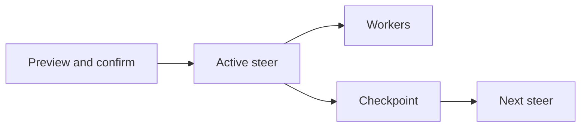

# paseo-workspace-factory (working title)

Workspace Factory sets up [Paseo](https://paseo.sh) projects, workspaces, and coordinating agents from a plan you review and confirm. One **steer** coordinates the project at a time and delegates bounded tasks to workers. When a provider reaches its limit or a chat grows too long, another steer can pick up the task from a compact **checkpoint**.

> Status: private preview. Not yet published; see [TODO.md](TODO.md) for what is missing before a release.

## Requirements

- Linux with util-linux (`flock`), Node.js ≥ 22, git, GitHub CLI (`gh`, authenticated)
- A running Paseo daemon (tested with 0.16.2) and its `paseo` CLI

## Quickstart

Follow [Getting started](docs/getting-started.md) to install and configure the plugin. Then open a regular agent tab in Paseo and use the composer.

| To | Type |
|---|---|
| Preview project setup | `/factory plan <you>/<repo>` |
| Apply the reviewed plan | `/factory apply <hash>` |
| See the active steer and its checkpoint | `/factory status` |
| Save a steer’s last checkpoint | `/factory checkpoint --from-agent <steer-id>` and confirm |
| Hand off to Steer B | `/factory switch --to B` and confirm |
| Recover an interrupted steer | `/factory resume` in its tab |
| See all commands | `/factory help` |

`npm test` runs the offline suite (simulated daemon, real processes and filesystem). Live tests against a daemon are opt-in, see [docs/configuration.md](docs/configuration.md#live-tests).

## Documentation

- [Concepts and safety model](docs/concepts.md)
- [Configuration](docs/configuration.md)
- [Steer instructions and task/answer template](docs/steer-instructions.md)
- [Optional TODO workflow](docs/todo-workflow.md)
- [All documentation](docs/README.md)
