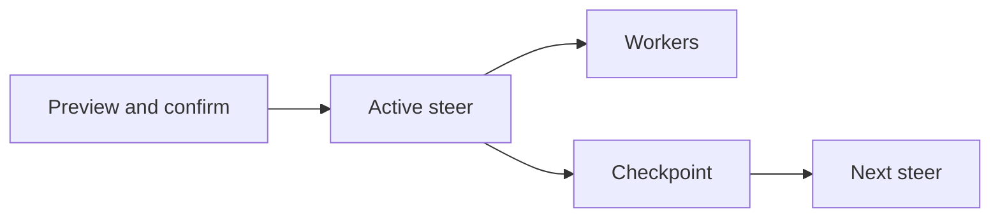

# paseo-workspace-factory (working title)

Workspace Factory sets up [Paseo](https://paseo.sh) projects, workspaces, and coordinating agents from a plan you review and confirm. One **steer** coordinates the project at a time and delegates bounded tasks to workers. When a provider reaches its limit or a chat grows too long, another steer can pick up the task from a compact **checkpoint**.

> Status: early preview.

## Requirements

- Linux with util-linux (`flock`), Node.js ≥ 22, git, GitHub CLI (`gh`, authenticated)
- A running Paseo daemon (tested with 0.16.2) and its `paseo` CLI

## Quickstart

Install on the Paseo host using either method.

| | [Build from source](docs/getting-started.md#build-from-source) | [Install a built release](docs/getting-started.md#install-a-built-release) |
|---|---|---|
| Install | Clone this repository and run `paseo plugin install <checkout>/plugin`. | Run `paseo plugin install <release-dir>` with a prepared, content-hashed release directory. |
| Update | Run `git pull` and `paseo plugin reload workspace-factory`. Settings survive reload. | Note your settings, remove the current installation, then install the next release directory. Removing the plugin deletes its settings. |
| Findings | **Ask agents to record factory findings** is on by default and directs agents to `<checkout>/FINDINGS.md`. | Unavailable. |

**Self-improvement when built from source.** An installation from the git checkout automatically adds a short passage to the prompts of new steers and workers: they record what they notice while using the factory (friction, expensive or wasted context, quota waste, unclear briefs, bugs) in `<checkout>/FINDINGS.md`. You decide which entries become tasks. Turn it off with **Ask agents to record factory findings** in the plugin settings. A normal installation from a built release never adds the passage.

After [host setup](docs/getting-started.md#configure-and-use-the-factory), open a regular agent tab in Paseo and use the composer.

| To | Type |
|---|---|
| Preview project setup | `/factory plan <you>/<repo>` |
| Apply the reviewed plan | `/factory apply <hash>` |
| See the active steer and its checkpoint | `/factory status` |
| Save a steer’s last checkpoint | `/factory checkpoint --from-agent <steer-id>` and confirm |
| Hand off to Steer B | `/factory switch --to B` and confirm |
| Recover an interrupted steer | `/factory resume` in its tab |
| See all commands | `/factory help` |

`npm test` runs the offline suite (simulated daemon, real processes and filesystem). Live tests against a daemon are opt-in, see [docs/configuration.md](docs/configuration.md#live-tests).

## Supported providers

Codex and Claude are the supported providers for steers and workers. Other providers in Paseo’s live catalog can be configured. Factory defaults Muse profiles to sensitive and rejects explicit thinking levels for Claude models on Copilot. Resume and cleanup capabilities vary by provider. Native `/clear` is enabled by default only for Claude, and the manual live-check matrix covers Codex and Claude. [Provider configuration](docs/configuration.md#known-provider-exceptions) · [Resume capabilities](docs/design/cold-context-resume.md#provider-matrix-e1) · [Provider live checks](docs/provider-live-check.md)

## Context and quota

- Give routine work to lower-cost workers. Keep steer chats short with `CHECKPOINT` blocks. Handoffs and resumes use a brief built from the saved checkpoint, git state and open workers. [Saving context](docs/saving-context.md) · [Concepts](docs/concepts.md)
- The plugin flags long idle chats whose cache may have expired. Optional cleanup can compact a still-warm chat mid-task. For cold context it can suggest `fresh`, which uses a same-tab rewind where supported or starts a new agent with the brief. [Cold-context design](docs/design/cold-context-resume.md) · [Cache profiles](docs/design/codex-research/spec-cache-profiles.md)
- Model selection skips known exhausted pools. Supervision can fail over to an eligible steer in another pool, with per-account quota and account selection when ZeroSub is configured. [Quota pools](docs/concepts.md#quota-pools-and-zerosub-accounts)

## Documentation

- [Concepts and safety model](docs/concepts.md)
- [Configuration](docs/configuration.md)
- [Steer instructions and task/answer template](docs/steer-instructions.md)
- [Optional TODO workflow](docs/todo-workflow.md)
- [All documentation](docs/README.md)
