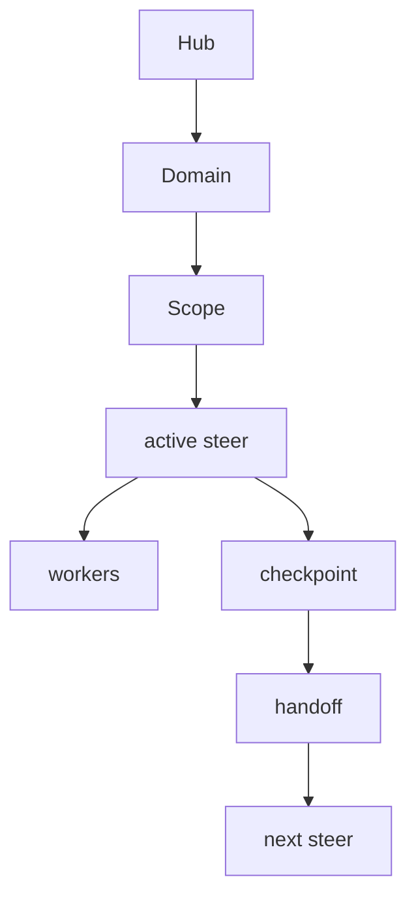

# Concepts and safety model

New to the factory? Start with [Getting started](getting-started.md); this page is the short mental model behind those workflows.

## Work in one scope

A **scope** is one coordinated unit, usually one repository: its home workspace, its steers (slots A–Z), one checkpoint and its workers. Kinds: `github` (`owner/repo`), `dir`, `workspace` (adopted), `hub` (at most one per host). State lives in the home workspace metadata; agents carry `wsf.*` labels.

The **active steer** coordinates your task. It can delegate bounded pieces to **workers** in parallel and records a **checkpoint** (`task`, `tests`, `blockers`, `next`) after each package. Workers stay where they are across handovers and are reused by ID.

Typical flow: `/factory plan <repo>` once, confirm `/factory apply <hash>`, then talk to the active steer. `/factory status` shows who is active and what the checkpoint says.

## Hand over without losing context

When a provider limit hits, the chat gets long, or another model fits better, the checkpoint moves — never the chat. A **handoff** is built from the checkpoint plus git state (branch, SHA, changes) and open workers; the previous steer's last answer travels only as a shortened, unverified hint.

- `/factory switch --to B`: another steer takes over.
- `/factory fresh` rewinds the agent in the same tab when supported and otherwise creates a new agent with the brief. `--slot` and `--worker` refresh a non-active steer or worker without takeover.
- `/factory resume`: the way back after a break, restart, or cleared chat.

Every switch raises the **epoch** counter, which invalidates older previews. Details: [provider limit](workflow-provider-limit.md), [saving context](saving-context.md).

## Coordinate many scopes

A **hub** scope coordinates other scopes: provisioning and lifecycle plans, slot/model assignment, priorities, cleanup. It never does content work inside a scope that has an active steer. A **domain** is a role, not a kind: any non-hub scope coordinating a group of child scopes (one product of several repos).

The chain is Hub → Domain → Child. Work flows down with `assign <scope> --task … --next …` (epoch-checked preview, then apply); blockers flow up as `domain:` (to the domain steer) and `hub:` (to the hub). Relations stay logical (metadata/labels); steers stay parent-free. See [domains](configuration.md#domains).

## Advisor steers and priority

Steer priority starts with A, then B, C, and so on. During failover, available quota can affect which candidate the factory wakes. Worker priority comes from `workers.priority`. Profile fallback applies when choosing a model for a new agent.

An advisor steer (slot profile with `"advisor": true`) answers explicit questions only: it is never made active, is skipped by failover, and gets no supervision wakes. `status`/`scopes` tag it `[advisor]`. Details: [managing models](configuration.md#managing-models-from-the-cli).

A profile with `"sensitive": true` only gets sanitized technical tasks, and its workers are skipped on private or unknown-visibility repositories. Details: [privacy](configuration.md#privacy-sensitive-profiles).

## Supervision survives interruptions

Workers belong to the scope, not to the steer that started them, so the active steer supervises every open worker even after a restart or replacement. The factory wakes the active steer for every actionable worker outcome (with only a tiny debounce) plus a watchdog when nothing happens. If the active steer does not answer, is advisor-flagged, or its quota pool is exhausted, the next ready steer from a different pool takes over on its own with an epoch-checked `switch`.

While workers run, the steer handles results as they arrive and works on independent items. Escalation runs from worker to steer, then to an advisor or the domain or hub steer. The user is asked when the remaining work needs their input. [Supervision design](design/supervision-design.md)

## Quota pools and ZeroSub accounts

Profiles share a quota pool (named by `profiles.<name>.pool`, else the provider). A pool at `quota.exhaustedPct` is skipped; configure at least two non-advisor steer pools so failover has somewhere to go. See `/factory quota` and [quota pools](configuration.md#quota-pools).

ZeroSub accounts are optional: when its daemon plugin is installed, families with ZeroSub accounts use per-account usage percents and `resetsAt` instead of the pool snapshot, judged against the same thresholds. Picks prefer the account with the most room; an exhausted family is skipped with its earliest reset time. Reads are best-effort with fallback to the usage snapshot, and account `email`/`organization`/`home` fields are never stored.

## Provisioning safety

- **Dry-run first.** `plan` never writes to GitHub, git or Paseo. It stores the complete plan as an authorization (`plans/<hash>.json`, never overwritten).
- **Confirmed plan only.** `apply --confirm <hash>` runs only that stored plan. After each step it rediscovers the state; the next operation must match the authorized one in every effect-relevant parameter, otherwise it stops and asks for a new dry-run.
- **Idempotent creation.** Workspaces and steers are created with daemon idempotency keys, with receipt recovery before anything else: recover the id, allow one first execution, or stop.
- **Parent-free steers.** Steers are created without `parent` and without a prompt; the parent label is verified after creation, and a link inherited from the calling agent is detached again right away. Fresh workers keep their previous parent, never the caller. CLI calls run without `PASEO_AGENT_ID`.
- **Paths.** Clone targets must stay below `checkoutRoot` without symlink components; the target's parent identity is re-checked right before cloning.
- **One apply at a time.** A kernel `flock` serializes `apply` runs on the host; switches and checkpoints use a per-workspace lock.
- **Conflicts are reported, never resolved automatically**: ambiguous checkouts, occupied targets, a different `upstream`, steers with a parent, duplicate main workspaces, unstartable profiles, unconfirmed adoption of unlabelled agents.

## Limits

- Locks protect cooperating factory processes on one host only. Agents, the Paseo UI and other hosts are not blocked.
- The active steer is a coordination rule, not an execution lock: a standby steer you message directly will still act.
- The receipt lookup uses an internal Paseo protocol message; it is pinned to the tested daemon version and fails closed otherwise.
- Worker archiving is preview-only: Paseo removes owned worktrees with `git worktree remove --force` when a workspace is archived.
